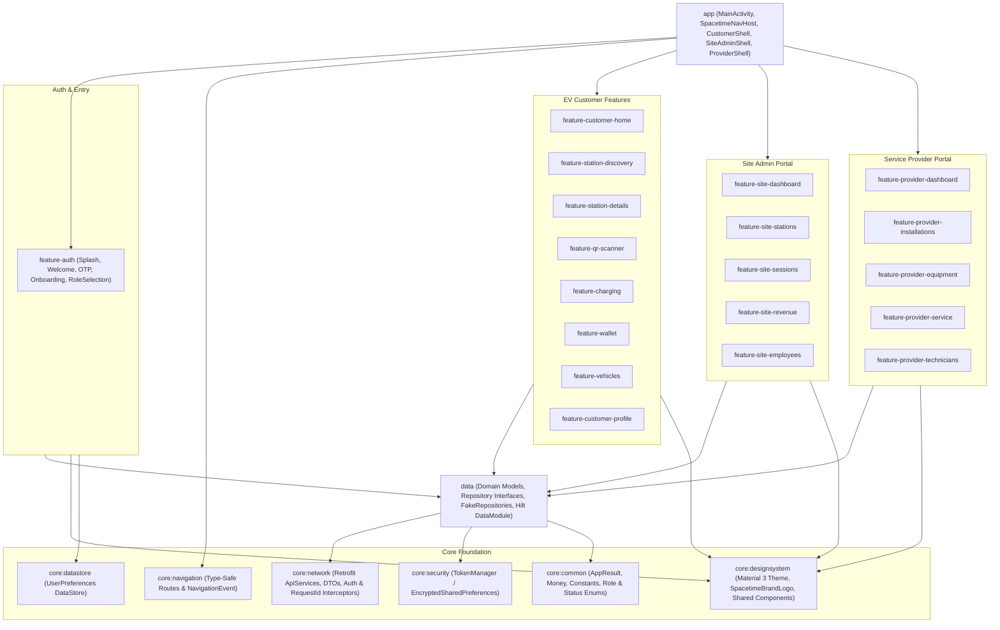
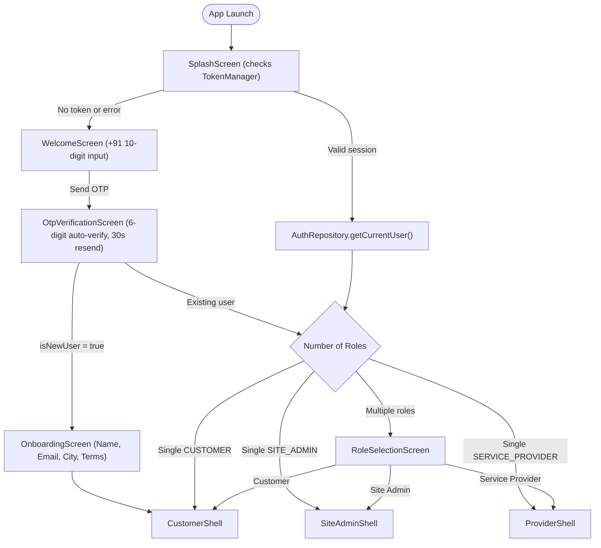
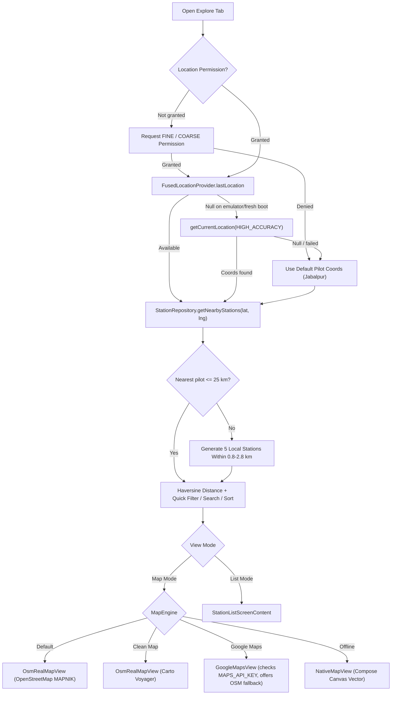
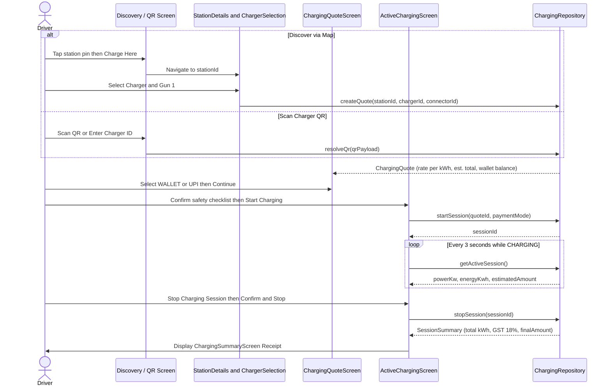
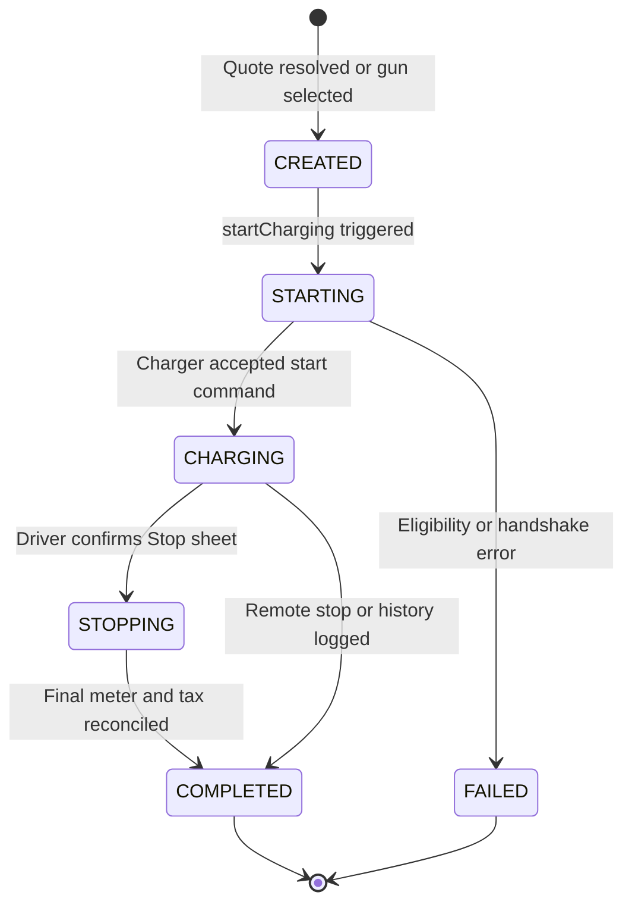
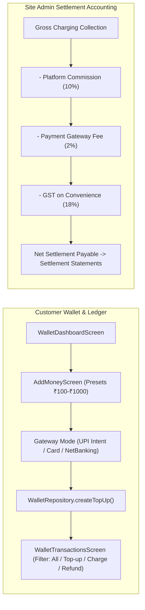

# ⚡ Spacetime Energy Futures

**Spacetime Energy Futures** is a multi-role Android EV charging platform built with **Kotlin**, **Jetpack Compose**, **Material 3**, **Hilt DI**, and **Clean Architecture**. It serves the Indian EV mobility ecosystem from a single application across three distinct workspaces:

- **EV Customer** — Discover nearby chargers on interactive OpenStreetMap street maps, scan charger QR codes, view transparent tariff quotes, monitor live charging telemetry, pay via wallet/UPI, and manage EVs.
- **Station Owner (Site Admin)** — Monitor real-time site KPIs, gun availability, live vehicle sessions, deduction-level revenue accounting, settlement statements, and role-based staff access.
- **Service Provider** — Manage turnkey charger installations, serialized hardware inventory, SLA repair tickets, and field technician dispatches.

> For milestone tracking see [`IMPLEMENTATION_PLAN.md`](IMPLEMENTATION_PLAN.md). For cloud backend, real OTP, and Razorpay setup instructions see [`PRODUCTION_SETUP_GUIDE.md`](PRODUCTION_SETUP_GUIDE.md).

---

## 🧭 Table of Contents

1. [Architecture & Module Structure](#-architecture--module-structure)
2. [Feature Breakdown by Role](#-feature-breakdown-by-role)
3. [Detailed Feature Flows & Diagrams](#-detailed-feature-flows--diagrams)
   - [Authentication & Multi-Role Routing](#1-authentication--multi-role-routing)
   - [Station Discovery & Multi-Engine Map Engine](#2-station-discovery--multi-engine-map-engine)
   - [End-to-End Charging & Billing Sequence](#3-end-to-end-charging--billing-sequence)
   - [Charging Session State Lifecycle](#4-charging-session-state-lifecycle)
   - [Wallet Top-Up & Site Revenue Flow](#5-wallet-top-up--site-revenue-flow)
4. [Tech Stack & Design System](#-tech-stack--design-system)
5. [Running Locally & Testing](#-running-locally--testing)

---

## 🏗️ Architecture & Module Structure

The app follows a modular **MVVM + Clean Repository Architecture** where UI feature modules depend only on domain repository interfaces (`:data`) and shared core modules (`:core/*`), allowing seamless switching between in-memory demo fakes (`FakeRepositories`) and live REST APIs (`core:network` + `api/openapi.json`).

### Module Inventory

| Layer | Modules | Responsibility |
|---|---|---|
| **App Shell** | `:app` | Single-activity host (`MainActivity` edge-to-edge), `SpacetimeNavHost`, and 3 bottom-navigation shells (`CustomerShell`, `SiteAdminShell`, `ProviderShell`) |
| **Core** | `:core:designsystem`, `:core:common`, `:core:navigation`, `:core:network`, `:core:security`, `:core:datastore`, `:core:testing` | Design tokens, reusable Compose components, encrypted token store, Retrofit services & interceptors, type-safe `@Serializable` routes |
| **Data** | `:data` | Domain models (`Station`, `Charger`, `ChargingQuote`, `Wallet`, `Vehicle`, etc.), 7 repository interfaces, Hilt bindings (`DataModule`), and pilot demo data (`FakeRepositories`) |
| **Customer** | `:feature-customer-home`, `:feature-station-discovery`, `:feature-station-details`, `:feature-qr-scanner`, `:feature-charging`, `:feature-wallet`, `:feature-vehicles`, `:feature-customer-profile` | Complete driver discovery, map, QR scan, quote, live charge, wallet, EV garage, and profile flows |
| **Site Admin** | `:feature-site-dashboard`, `:feature-site-stations`, `:feature-site-sessions`, `:feature-site-revenue`, `:feature-site-employees` | Site KPIs, network health, station readiness, active sessions, deductions/settlements, staff access |
| **Service Provider** | `:feature-provider-dashboard`, `:feature-provider-installations`, `:feature-provider-equipment`, `:feature-provider-service`, `:feature-provider-technicians` | Provider metrics, installation stage tracking, serialized equipment inventory, SLA tickets, technicians |

---

## 🚀 Feature Breakdown by Role

### 1. Authentication & Role Routing (`:feature-auth`)
- **Branded Splash & Auto-Resume:** Checks encrypted token status (`TokenManagerImpl`), verifies current user profile, and routes either to login or directly into the user's workspace.
- **Mobile + OTP Flow:** 10-digit Indian mobile validation (`+91`), 6-digit OTP entry with auto-submit, and a 30-second resend cooldown timer.
- **New-User Onboarding:** Captures full name, optional email, city, and terms acceptance.
- **Multi-Role Workspace Switcher:** Users holding multiple roles (e.g., `Rahul Sharma` in demo mode holds `Customer`, `Site Admin`, and `Service Provider`) choose their workspace on `RoleSelectionScreen` or switch anytime via Profile.

### 2. EV Customer Workspace (`CustomerShell`)
Bottom Navigation Tabs: **Home** • **Explore** • **Charging** • **Wallet** • **Profile**

- **Home (`CustomerHomeScreen`):** Gradient Spacetime Wallet balance card, quick-tap search bar (opens Explore), 4 quick actions (**Scan QR**, **Nearby**, **Fast DC**, **Saved**), live active-session banner if charging is running, and nearby charging hubs.
- **Explore (`ExploreMapScreen`):**
  - **4 Map Engines:** Native OpenStreetMap Street (`OsmRealMapView` MAPNIK default, no API key required), Carto Voyager (`Clean Map`), Google Maps SDK (`GoogleMapsView` with automatic fallback prompt if `MAPS_API_KEY` is empty), and an offline Canvas vector map (`NativeMapView`).
  - **Custom Station Pins & Preview:** Price + availability pins (`₹14 • 4/6`), tap-to-preview bottom card with rating, amenities, **Directions** (`geo:` intent), and **Charge Here** CTA.
  - **Search, Quick Filters & List Mode:** Instant search dropdown, quick chips (`All`, `Fast DC`, `Available Now`, `24/7 Open`, `Lowest Tariff`), full filter bottom sheet (category, max distance slider `5–50 km`, 24/7 toggle), and a List View with 4 sort modes (`Nearest`, `Lowest Price`, `Fastest`, `Top Rated`).
  - **Dynamic Local Discovery:** Uses `FusedLocationProviderClient` (`lastLocation` + `getCurrentLocation` fallback). When testing outside Jabalpur/Bhopal pilot coordinates (>25 km), `FakeStationRepository` generates nearby local stations so the map is always populated around the user's real GPS location.
- **Station & Charger Selection (`StationDetailsScreen`, `ChargerSelectionScreen`):** Favorite heart toggle, station navigation intent, amenities, operating hours, and real-time gun/connector availability (`CCS2`, `Type 2`, kW rating, `ChargerStatusChip`).
- **QR Scan & Charging (`QrScannerScreen`, `ChargingQuoteScreen`, `ChargingStartConfirmationScreen`, `ActiveChargingScreen`, `ChargingSummaryScreen`):**
  - Animated viewfinder laser scanner + manual Charger ID dialog + one-tap simulation (`EVCHARGE:CHG-01-DC`).
  - Itemized tariff quote card (energy rate, activation fee, parking fee, idle fee, estimated total) with **Spacetime Wallet** or **Direct UPI** payment selection.
  - Pre-start safety checklist (`Connector locked`, `Ignition off`, `Payment authorized`).
  - Animated active charging screen polling meter telemetry (`kWh`, `kW`, duration, estimated ₹) with a bottom-sheet Stop confirmation and itemized GST receipt summary.
- **My Charging Sessions (`MyChargingSessionsScreen`):** Total completed sessions, total energy added (`kWh`), live session quick jump, past receipt cards, and a **Scan & Charge** FAB.
- **Wallet (`WalletDashboardScreen`, `AddMoneyScreen`, `WalletTransactionsScreen`):** Spendable & promotional balances, preset top-ups (`₹100`, `₹200`, `₹500`, `₹1000`), gateway modes (UPI Intent, Card, NetBanking), and category-filtered ledger (`All`, `Top-ups`, `Charging`, `Cashback / Refunds`).
- **Profile & EV Garage (`CustomerProfileScreen`, `VehicleListScreen`, `AddVehicleScreen`, `SavedStationsScreen`, `NotificationsScreen`, `HelpSupportScreen`):** EV impact stats (sessions, kWh, CO2 offset), multi-vehicle garage with default toggle & connector specs (`CCS2`, `Type 2`, `GB/T`, `CHAdeMO`), saved hubs, categorized alerts, and SLA support ticket submission.

### 3. Station Owner / Site Admin Portal (`SiteAdminShell`)
Bottom Navigation Tabs: **Overview** • **Stations** • **Sessions** • **Revenue** • **Staff**

- **Overview:** Gross revenue, dispensed energy (`kWh`), sessions today, unique drivers, and live gun health breakdown (`Available`, `In Use`, `Offline / Faulted`).
- **Stations:** Multi-site readiness list showing open status, gun counts, tariffs (`₹/kWh`), and schedules.
- **Live Sessions:** Real-time active charging dispatches showing charger/gun, masked customer mobile (`+91 98765****10`), live `kW`/`kWh`, and accrued ₹.
- **Revenue & Settlements:** Net settlement balance (paid vs. pending clearing), accounting breakdown (**Gross Collection**, **Platform Commission 10%**, **Gateway Fee 2%**, **GST 18%**), and weekly settlement statement history.
- **Staff:** Role-based personnel directory (`Site Manager`, `Station Operator`, `Accountant`) with an invite dialog.

### 4. Service Provider Portal (`ProviderShell`)
Bottom Navigation Tabs: **Overview** • **Installs** • **Service** • **Assets** • **Staff**

- **Overview:** Enterprise client count, chargers installed, active/pending installations, open tickets, and expiring warranties.
- **Installations:** Turnkey lifecycle tracking (`SURVEY_PENDING` → `QUOTATION_SUBMITTED` → `INSTALLATION_IN_PROGRESS` → `COMMISSIONING_PENDING` → `COMPLETED`) with ability to create new projects and advance stages.
- **Service & SLA Tickets:** Priority queue (`HIGH` / `MEDIUM` / `LOW`), SLA countdowns, technician assignment, and ticket resolution.
- **Equipment Inventory:** Serialized EVSE tracking (`INSTALLED`, `DISPATCHED`, `IN_STOCK`, `UNDER_MAINTENANCE`), rated kW, connectors, and warranty expiry dates.
- **Field Technicians:** Certified electrical & EVSE engineer directory showing service region, skills, and `AVAILABLE` / `ON_DUTY` status.

---

## 🔄 Detailed Feature Flows & Diagrams

### 1. Authentication & Multi-Role Routing

### 2. Station Discovery & Multi-Engine Map Engine

### 3. End-to-End Charging & Billing Sequence

### 4. Charging Session State Lifecycle

### 5. Wallet Top-Up & Site Revenue Flow

---

## 🎨 Tech Stack & Design System

### Core Libraries (from `gradle/libs.versions.toml`)
- **Language & Build:** Kotlin `2.1.0`, Android Gradle Plugin `8.7.3`, KSP `2.1.0-1.0.29`, `minSdk 26`, `compileSdk 35`, `targetSdk 35`
- **UI & Navigation:** Jetpack Compose BOM `2025.01.01`, Material 3, Material Icons Extended, Compose Navigation `2.8.5` (type-safe routes via `kotlinx-serialization-json 1.7.3`)
- **DI & Async:** Hilt `2.52`, Kotlin Coroutines `1.9.0`
- **Maps & Location:** `osmdroid-android 6.1.20` (default street & Carto Voyager maps), Google Maps Compose `6.2.1`, `play-services-location 21.3.0`
- **Networking & Storage:** Retrofit `2.11.0`, OkHttp `4.12.0`, `androidx.security:security-crypto 1.1.0-alpha06` (`EncryptedSharedPreferences`), DataStore Preferences `1.1.2`
- **Testing:** JUnit `4.13.2`, MockK `1.13.13`, Turbine `1.2.0`, `kotlinx-coroutines-test`

### Brand Palette (`core:designsystem`)
| Token | Hex | Usage |
|---|---|---|
| `Primary` | `#087F5B` | Primary CTAs, active tabs, EV availability highlights |
| `PrimaryLight` | `#0CA678` | Brand gradients, dark-mode/navy contrast accents |
| `Secondary` | `#102A43` | Wallet/revenue dark hero cards, high-emphasis elements |
| `AppBackground` | `#F6F8FA` | Screen surface canvas |
| `CardBackground` | `#FFFFFF` | Elevated cards, sheets, top/bottom bars |
| `Success` / `Warning` / `Error` | `#16A34A` / `#F59E0B` / `#DC2626` | Connector health, occupied states, faults & SLA alerts |

---

## 🛠️ Running Locally & Testing

### Launch in Android Studio
1. Open `/Users/live4yashi/Documents/Spacetime` in **Android Studio Ladybug (2024.2+)** or newer.
2. Ensure **Gradle JDK 17+** is selected (`Settings → Build, Execution, Deployment → Build Tools → Gradle`).
3. Let Gradle sync download dependencies (including `osmdroid-android` for OpenStreetMap).
4. Select the **`app`** run configuration and run on an emulator or physical Android device (`API 26+`).
5. **Demo Sign-In:** Enter any 10-digit mobile number and any 6-digit OTP to test all three workspaces (`Customer`, `Site Admin`, `Service Provider`).
6. *(Optional Google Maps)*: OpenStreetMap works out of the box with no key; to also enable the Google Maps layer option, add `MAPS_API_KEY=your_key` to `local.properties` or `gradle.properties`.

### Unit Tests
Unit test suites exist across feature ViewModels (`WelcomeViewModelTest`, `StationDiscoveryViewModelTest`, `ChargingViewModelTest`, `WalletViewModelTest`, `VehiclesViewModelTest`, `SiteRevenueViewModelTest`, `ProviderInstallationsViewModelTest`) and can be run directly from Android Studio's test runner or Gradle (`testDebugUnitTest`).

### Companion Documentation
- [`IMPLEMENTATION_PLAN.md`](IMPLEMENTATION_PLAN.md) — Module progress & cloud production roadmap (Phases 9–12)
- [`PRODUCTION_SETUP_GUIDE.md`](PRODUCTION_SETUP_GUIDE.md) — Cloud backend, PostgreSQL schema, TRAI DLT + MSG91/Twilio OTP, Razorpay webhooks, and API cutover steps
- [`api/openapi.json`](api/openapi.json) — Authoritative OpenAPI 3.1 REST & WebSocket contract
