# App Walkthrough: Spacetime Energy Futures

This document contains a comprehensive walkthrough of the core screens in the Spacetime Energy Futures app, broken down by user workspace roles: Customer (EV Driver), Site Admin (Station Host), and Service Provider (Field Ops).

## 1. Workspace Selection
When the app launches (or when switching via the Profile tab), the user is presented with a workspace selector.

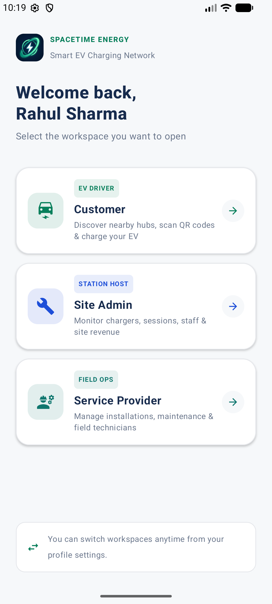

This central hub allows switching between different user roles, customizing the entire app experience based on the selected persona.

---

## 2. Customer (EV Driver) Workspace
The Customer workspace is designed to help drivers locate chargers, initiate charging sessions, and manage their wallet.

### Station Discovery (Map)
The landing screen features a custom high-performance native Jetpack Compose vector map engine to render geographic coordinates, road networks, user location, and interactive station markers.

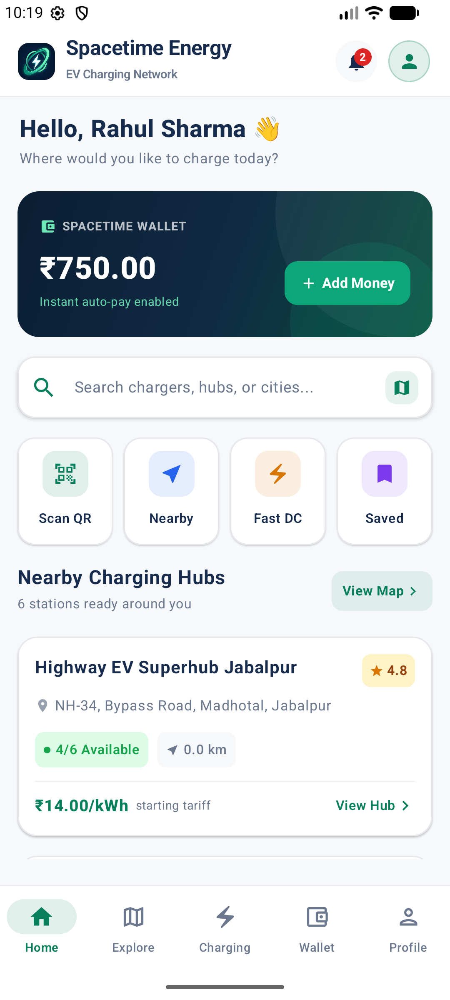

### Station Details
Tapping on a station marker opens the Station Details view, providing comprehensive information about available connectors, pricing, and amenities.

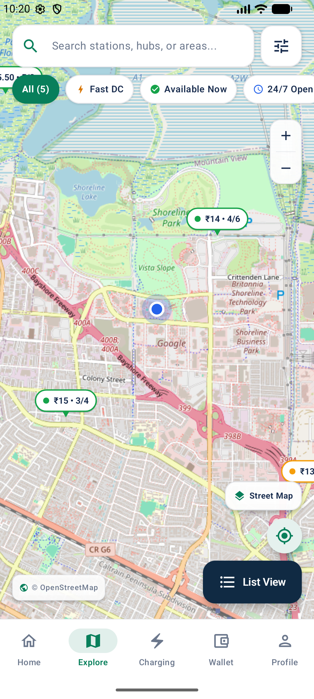

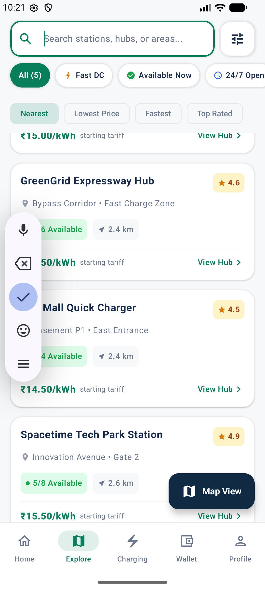

### QR Scanner & Charging Sessions
Users scan the QR code located on the physical charger to authenticate and begin the charging process. The "Charging" tab shows active and past charging sessions.

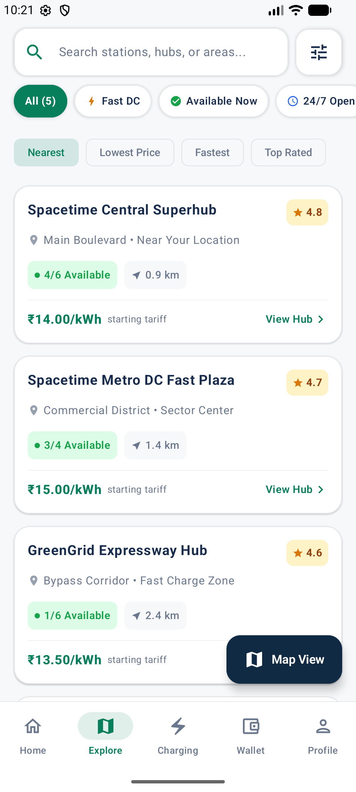

### User Profile
The "Profile" tab provides access to user settings, payment methods, and account information, including a button to switch workspaces.

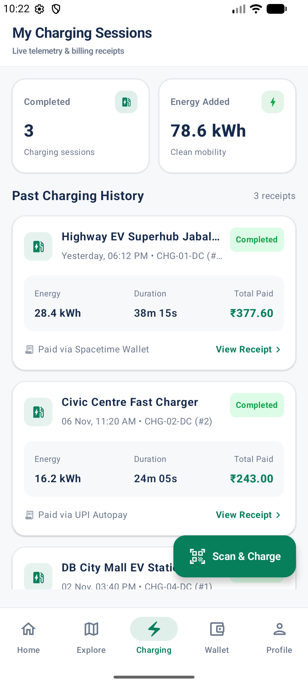

---

## 3. Site Admin (Station Host) Workspace
The Site Admin workspace gives station owners and managers a bird's-eye view of their charging infrastructure.

### Admin Dashboard (Overview)
Provides high-level metrics such as gross revenue, energy dispensed, active sessions, and the overall health of the charger network.

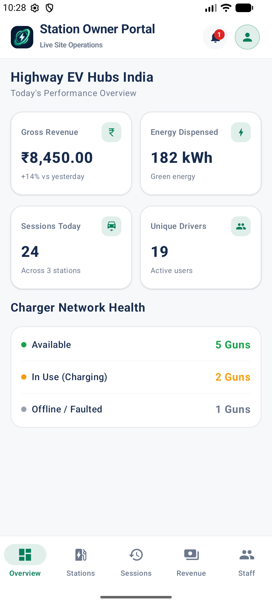

### Station Management
The "Stations" tab lists all owned or managed EV stations. Admins can monitor operational readiness, charger statuses, and tariffs at a glance.

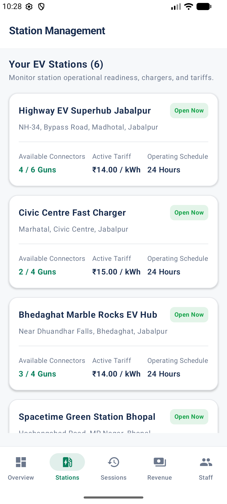

### Charging Sessions
The "Sessions" tab allows monitoring live and past charging sessions happening across all managed stations.

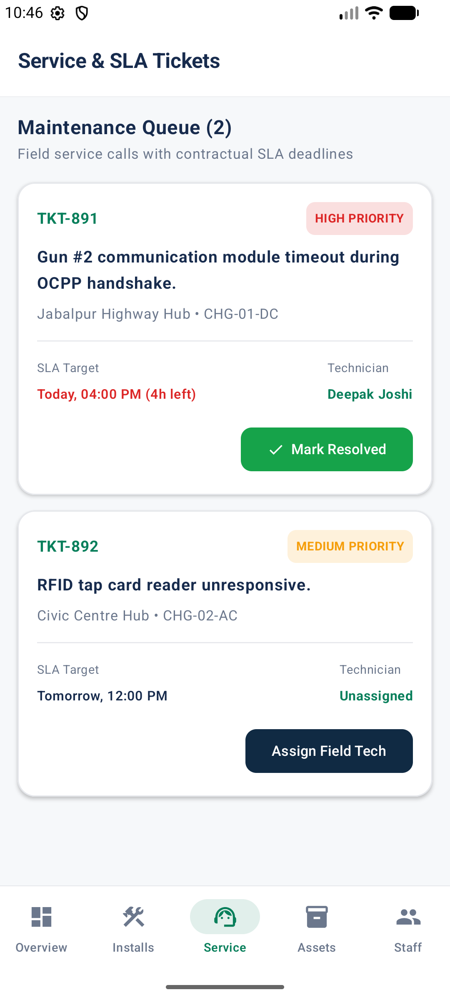

### Revenue Tracking
The "Revenue" tab displays financial reporting, tracking income from charging sessions and providing earnings insights.

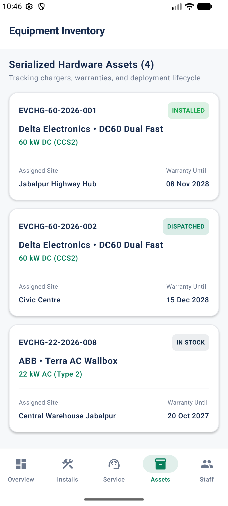

### Staff Management
The "Staff" tab helps manage personnel, assign roles, and control access permissions for the site operators.

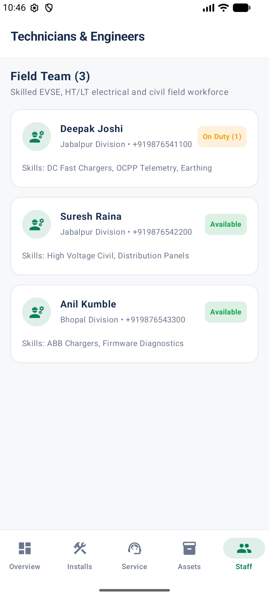

---

## 4. Service Provider (Field Ops) Workspace
This workspace is designed for technicians and field operation teams responsible for the maintenance and deployment of chargers.

### Provider Dashboard (Overview)
Displays critical field operational metrics, pending service requests, and hardware inventory details for technicians on the move.

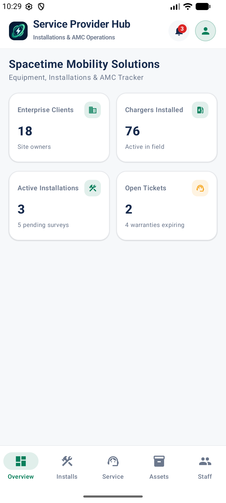

### Installation Pipeline
The "Installs" tab details specific assignments for the technician, such as new charger installations, tracking survey, and commissioning status.

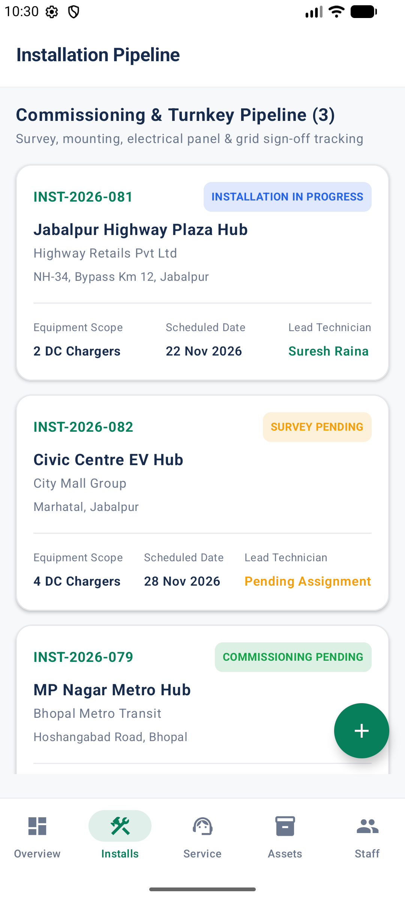

### Maintenance & Service Tasks
The "Service" tab shows active service tickets, routine maintenance tasks, and faulted equipment requiring attention.

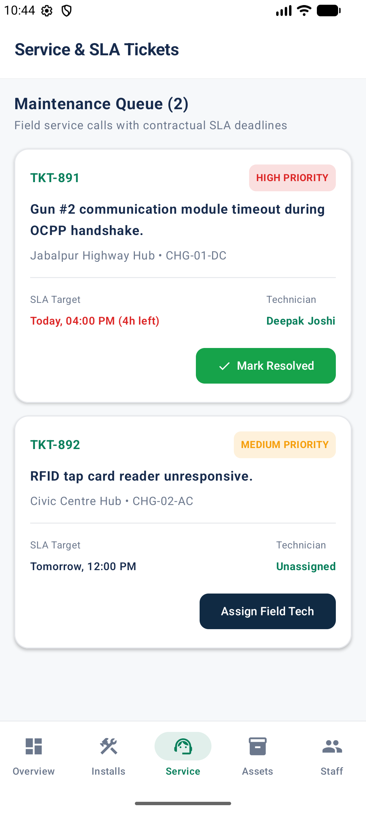

### Hardware Assets
The "Assets" tab manages the inventory of chargers, spare parts, and tools assigned to the field ops team.

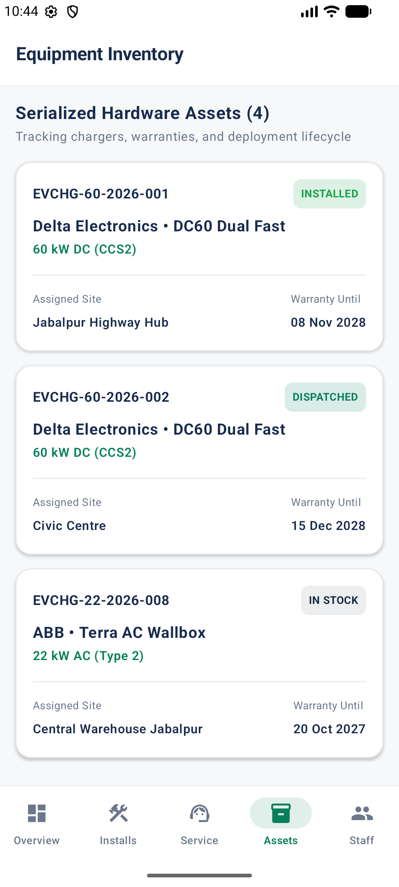

### Technician Roster
The "Staff" tab lists the field technicians, their current assignments, and availability status.

